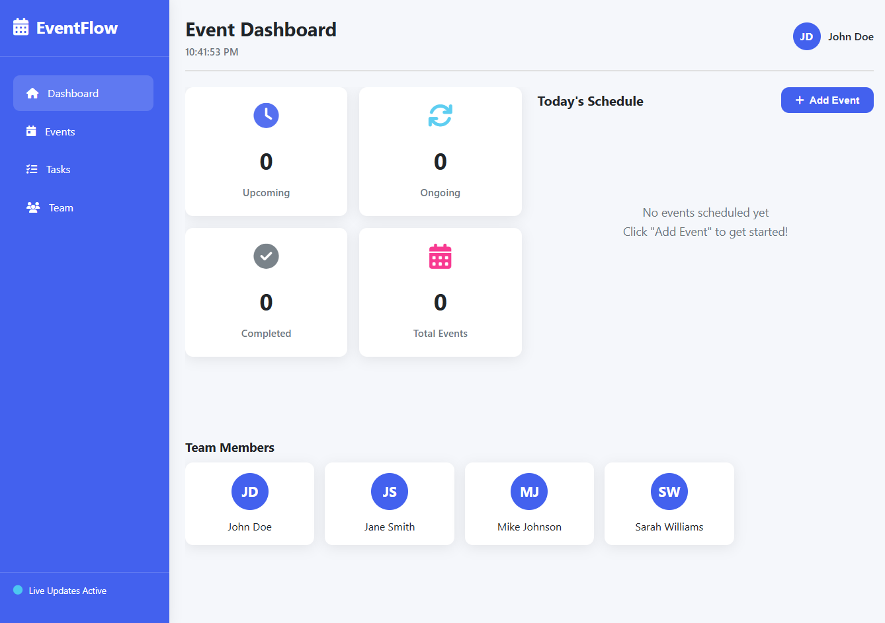
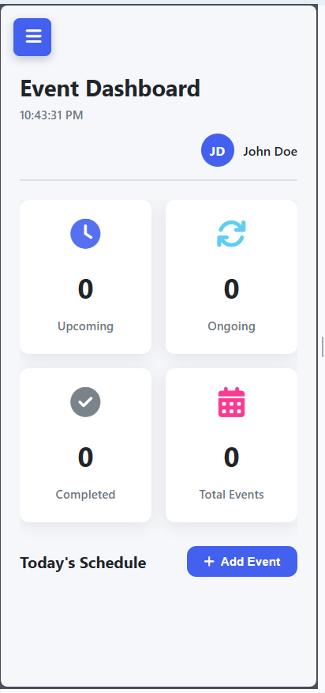
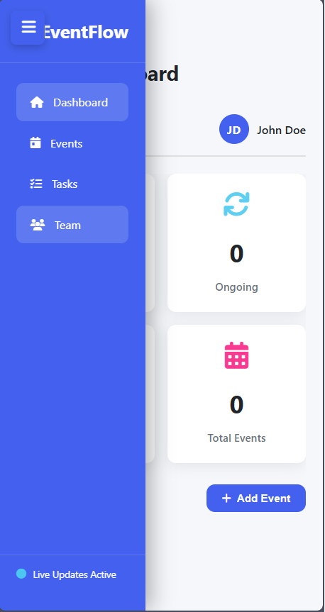

# EventFlow Dashboard

**A real-time, beautiful, zero-dependency event dashboard built with pure vanilla JavaScript.**

No React. No Vue. No build step. Just HTML, CSS, and modern ES6 modules.

### Dashboard

<p align="center">
  
</p>

<div align="center">

| Desktop View                                      | Mobile View                                          |
|---------------------------------------------------|-------------------------------------------------------|
|  |  |

</div>

### Mobile Sidebar & Menu

<div align="center">
  
  <br><br>
  <em>Smooth slide-in sidebar with functional tab navigation</em>
</div>

### Unified Event/Task System

<div align="center">
  
  <br><em>Single modal for both events (with time) and tasks (with priority)</em>
</div>

### Task Priority Badges

<div align="center">
  
  <br><em>Visual priority indicators for tasks (High/Medium/Low)</em>
</div>

---

## Features

- **Unified Event/Task System** - Create both timed events and priority-based tasks
- **Task Priority System** - High/Medium/Low with visual color-coded badges
- **Create, edit, and delete items** with full date/time support
- Items automatically **grouped by date** and **sorted** (events by time, tasks by priority)
- Real-time clock + simulated live updates every 30s
- Full **localStorage persistence** — survives refresh and closes
- Beautiful modals, toast notifications, loading states
- Mobile-first responsive design with hamburger menu
- **Edit/Delete** with confirmation modal
- Dynamic form fields - time for events, priority for tasks
- Form validation + error handling
- 100% vanilla JS — zero dependencies, instant load

---

## Tech Stack

| Layer             | Technology                          |
|-------------------|-------------------------------------|
| Language          | Vanilla JavaScript (ES6+ modules)   |
| Styling           | CSS3 (component-based organization)|
| Icons             | Font Awesome 6                      |
| Testing           | Playwright (10 E2E tests)           |
| Dev Server        | ```http-server``` (via npm scripts) |
| Dependencies      | **Zero**                            |

> Yes, this entire dashboard has **no npm packages** except dev tools.

---

## Quick Start

```
git clone https://github.com/morrowchristian/event-dashboard.git
cd event-dashboard
npm install          # only installs http-server + playwright
npm run dev          # → http://localhost:5500
```

Run Tests:
```
npm test        #headed mode: npm run test: headed
```

---

## Current Status

**Unified Event/Task System Live** — All features working:

- ✅ Unified schedule showing events and tasks together
- ✅ Task priority system with visual badges
- ✅ Dynamic form with conditional fields
- ✅ Functional sidebar navigation with tab switching
- ✅ Mobile-responsive with working hamburger menu
- ✅ Component-based CSS architecture

**Architecture:**
- Clean separation of concerns with ```src/components/```, ```src/ui/```, ```src/services/```
- Single barrel export for utilities (```src/index.js```)
- Event-driven updates with custom events
- Pure static rendering - no virtual DOM, just fast native DOM updates

**Test Status:**
- 10 Playwright E2E tests in `src/tests/eventflow-full.test.js` (run with `npm run test:start`)
- 4 of 10 pass (verified locally); 6 fail against the current unified system (mobile menu toggle, add/edit/delete flows, form validation, sorting) — the test suite needs updating for the unified system

---

## License

[MIT](LICENSE) — free to use, modify, and ship

---

<div align="center">
  <strong>Made with passion • Zero Dependencies • Pure Vanilla JS</strong>
</div>